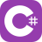

### Hi, I'm Omar 👋

Software engineer building production AI systems — model evaluation, real-time voice, and the backend services that keep them reliable.

I care about the unglamorous parts: evals, failure analysis, and making AI systems boring in production.

**What I work on**

- **Production LLM systems & evaluation:** controlled experiments, cross-model comparison, telling model failures apart from code and infrastructure failures
- **Real-time AI:** voice agents, speech recognition, streaming
- **Backend & distributed services:** Python and .NET microservices, event-driven pipelines
- **AI tooling & secure infrastructure:** MCP, agents, zero-trust access

**Stack**

<table>
  <tr>
    <td><b>Languages</b></td>
    <td>
      
      
      
      
    </td>
  </tr>
  <tr>
    <td><b>Frameworks</b></td>
    <td>
      
      
      
      
    </td>
  </tr>
  <tr>
    <td><b>AI &amp; Voice</b></td>
    <td>
      
      
      
      
      
    </td>
  </tr>
  <tr>
    <td><b>Data &amp; Messaging</b></td>
    <td>
      
      
      
      
    </td>
  </tr>
  <tr>
    <td><b>Cloud &amp; Infra</b></td>
    <td>
      
      
      
      
      
      
      
    </td>
  </tr>
  <tr>
    <td><b>CI &amp; Observability</b></td>
    <td>
      
      
      
      
    </td>
  </tr>
</table>

**Connect**

